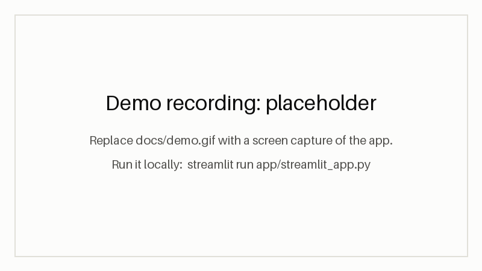
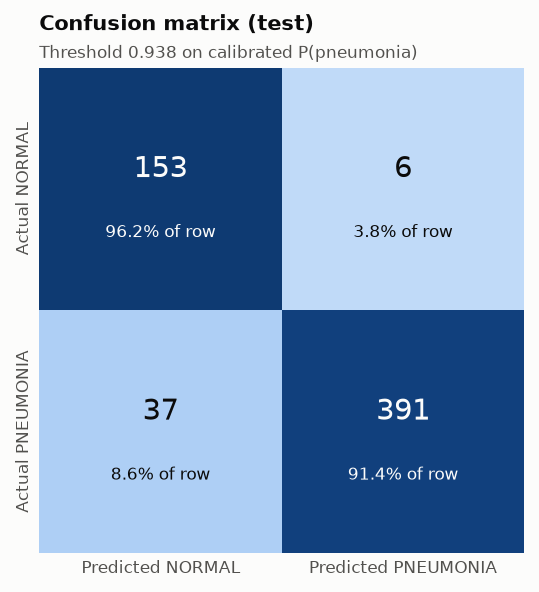
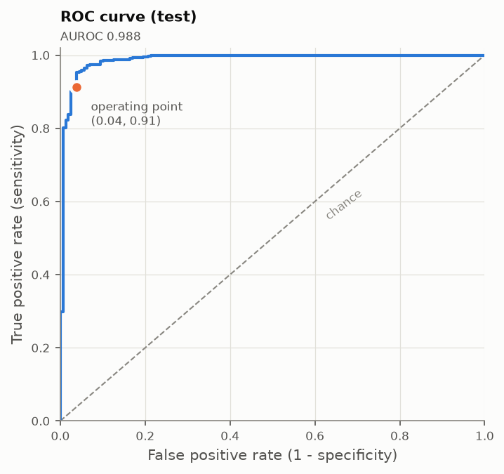
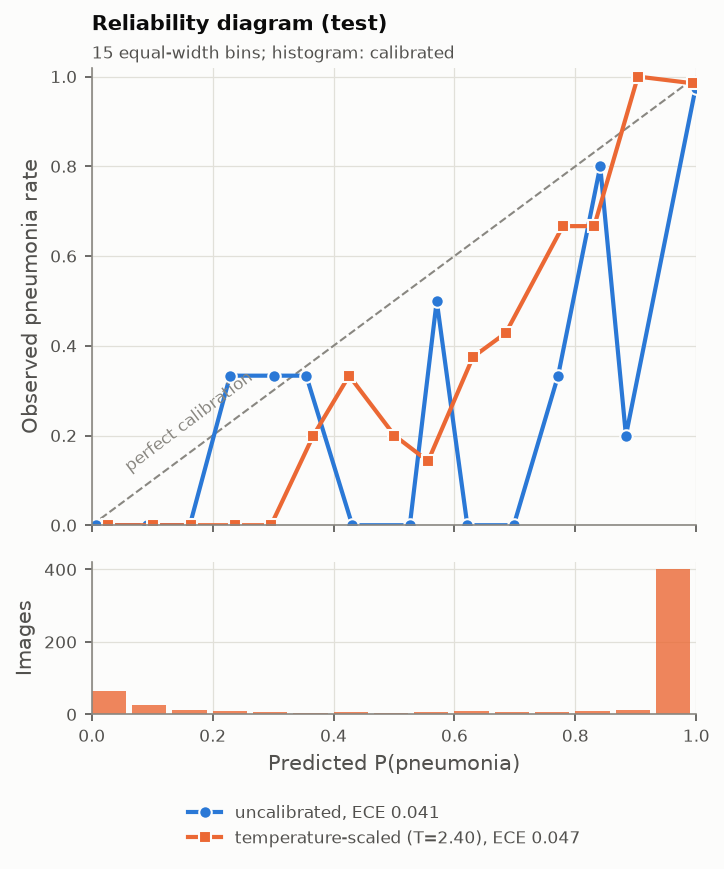
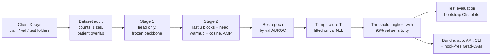

# AI Lung Disease Detection

Pneumonia vs normal classification of pediatric chest X-rays with a fine-tuned
EfficientNet-B0, temperature-scaled probabilities and Grad-CAM, served as a Streamlit
app, a REST API and a command-line tool. **Research and education only; not a medical
device.**

[](https://github.com/Utkarshraj5758/AI-Lung-Disease-Detection/actions/workflows/ci.yml)
[](LICENSE)
[](pyproject.toml)

> Read the [Limitations](#limitations) before relying on any number below: the model was
> trained and tested on one pediatric dataset whose splits share patients.



*The demo recording is a placeholder until a screen capture of the app is added.
Live demo: not deployed yet (see [Hugging Face](#hugging-face-weights-and-spaces)).*

## Results

<!-- BEGIN GENERATED: results -->
Test split: **587 images** (159 NORMAL, 428 PNEUMONIA). Decision threshold **0.938** on temperature-scaled P(pneumonia) (T = 2.40); both were fitted on the validation split, never on test. 95% CIs in parentheses: percentile bootstrap, 1000 resamples, seed 42. ECE uses 15 equal-width bins on P(pneumonia).

| Metric | All test images (n = 587) | Test patients not in train (n = 240) |
| --- | --- | --- |
| AUROC | 0.988 (0.976–0.996) | 0.979 (0.963–0.992) |
| AUPRC | 0.994 (0.987–0.998) | 0.963 (0.925–0.989) |
| Accuracy | 92.7% (90.5–94.7) | 91.2% (87.5–94.6) |
| Sensitivity (recall) | 91.4% (88.8–94.0) | 84.0% (75.9–91.0) |
| Specificity | 96.2% (92.7–98.8) | 95.9% (92.3–98.7) |
| PPV (precision) | 98.5% (97.1–99.5) | 92.9% (86.9–97.8) |
| NPV | 80.5% (74.9–86.1) | 90.3% (85.4–94.5) |
| F1 | 0.948 (0.932–0.962) | 0.883 (0.829–0.928) |
| ECE | 0.047 (0.038–0.065) | 0.122 (0.097–0.158) |

> **Patient overlap.** 347 of the 587 test images come from the 299 patients who also appear in the training split (the dataset folders were used as provided; see [Limitations](#limitations)), so the left column is optimistic. The right column keeps only test patients never seen in training (146 NORMAL, 94 PNEUMONIA); its class mix differs, so PPV and NPV are not comparable across the columns.

Confusion matrix (all test images): 391 true positives, 37 false negatives (missed pneumonia), 6 false positives, 153 true negatives.

Validation split (585 images; used only for model selection, the temperature and the threshold): the threshold is the highest reaching 95% sensitivity there (95.1%, specificity 96.8%; Youden-J threshold 0.902). Validation AUROC 0.994.

Temperature scaling (T = 2.40) changed test ECE from 0.041 to 0.047; on validation it lowered NLL from 0.192 to 0.131 while ECE went from 0.046 to 0.052.

<p align="center">
  
  
  
</p>

<sub>Generated by `scripts/render_results.py` from `reports/metrics.json`: efficientnet_b0 trained at commit e6f1605, evaluated at commit d43fe7d on 2026-10-20, dataset fingerprint `2f402612cb0c6f1d`.</sub>
<!-- END GENERATED: results -->

More plots: [precision-recall](reports/pr.png),
[Grad-CAM examples](reports/gradcam_examples.png). Details in the
[model card](docs/MODEL_CARD.md).

## How it works



- **Data.** The dataset's `train/`, `val/` and `test/` folders are used as provided.
  Patient ids are parsed from the file names and the overlap between splits is measured
  and reported, not fixed. Images are greyscale, repeated to three channels so the
  ImageNet weights can be reused. Training augmentation is mild (crop, rotation,
  translation, brightness/contrast); horizontal flips are off by default because anatomy
  is asymmetric.
- **Training.** ImageNet-pretrained EfficientNet-B0. Stage 1 trains the new head on a
  frozen backbone (BatchNorm kept in eval mode); stage 2 unfreezes the last three feature
  blocks with a 10x lower learning rate. Class imbalance is handled with a weighted loss.
  All settings are in [`configs/default.yaml`](configs/default.yaml).
- **Calibration and threshold.** A single temperature is fitted on the validation logits,
  then the decision threshold is set on validation as the highest one that still reaches
  95% sensitivity. The test split is only used once, for the final report.
- **Bundle.** `artifacts/best.pt` holds the weights plus everything inference needs:
  class names, preprocessing, threshold, temperature, training config, git commit, dataset
  fingerprint and metrics. It loads with `torch.load(weights_only=True)`.
- **Explanations.** Grad-CAM is computed without hooks, so one model can serve concurrent
  requests. An output is flagged *borderline* when its probability is within a fixed
  log-odds margin of the threshold.

## Quickstart

### Install

Python 3.10 or newer. For a CPU-only install:

```bash
git clone https://github.com/Utkarshraj5758/AI-Lung-Disease-Detection.git
cd AI-Lung-Disease-Detection
pip install torch torchvision --index-url https://download.pytorch.org/whl/cpu
pip install -e ".[api]"
```

For an NVIDIA GPU, install the CUDA build of `torch` and `torchvision` that matches your
driver from [pytorch.org](https://pytorch.org/get-started/locally/) instead (for example
`--index-url https://download.pytorch.org/whl/cu126`), then `pip install -e ".[api]"`.
Contributors: `pip install -e ".[dev,api,train]"` or `make setup`.

### Get a model bundle

No weights are published yet. Train your own ([below](#reproduce-training)), which writes
`artifacts/best.pt`, or download a bundle that has been uploaded to a Hugging Face model
repo:

```bash
python scripts/download_weights.py --repo-id <user>/<model-repo>
```

### Run

```bash
streamlit run app/streamlit_app.py          # web app on http://localhost:8501
uvicorn api.main:app --port 8000            # REST API, interactive docs on /docs
lungxray predict xray.png --cam overlay.png # CLI; add --json for machine-readable output
```

The API answers `GET /health` and `POST /predict`. Send the image as the multipart field
`file` (PNG, JPEG or DICOM, at most 10 MB); add `?explain=true` for a base64 PNG Grad-CAM
overlay:

```bash
curl -F "file=@xray.png;type=image/png" "http://localhost:8000/predict?explain=true"
```

The app, API and CLI find the bundle through these settings:

| Setting | Meaning |
| --- | --- |
| `LUNGXRAY_WEIGHTS` | Path to a bundle (default `artifacts/best.pt`; the app also takes `-- --weights PATH`, the CLI `--weights`) |
| `LUNGXRAY_HF_REPO` | Hugging Face model repo to download the bundle from if the local file is missing (or `app.hf_repo_id` in the config) |
| `LUNGXRAY_HF_FILENAME` | File name in that repo (default `best.pt`) |
| `LUNGXRAY_DEVICE` | API only: torch device, e.g. `cpu` or `cuda` (default: CUDA if available) |

### Docker

```bash
docker build -t lungxray .
docker run -p 8501:8501 -v "$PWD/artifacts:/app/artifacts:ro" lungxray
```

The image is CPU-only, runs as a non-root user and contains no weights: mount a bundle at
`/app/artifacts/best.pt` or pass `-e LUNGXRAY_HF_REPO=<user>/<model-repo>`. For the API,
build with `--build-arg SERVICE=api` or run with `-e LUNGXRAY_SERVICE=api -p 8000:8000`.

### Hugging Face: weights and Spaces

Upload a trained bundle (and its model card) to a model repo:

```bash
hf auth login
hf repos create <user>/lungxray-efficientnet-b0 --type model
hf upload <user>/lungxray-efficientnet-b0 artifacts/best.pt best.pt
hf upload <user>/lungxray-efficientnet-b0 docs/MODEL_CARD.md README.md
```

Then deploy the app as a [Hugging Face Space](https://huggingface.co/docs/hub/spaces)
with the Streamlit SDK. `scripts/build_space.py` assembles the Space in `build/space/`:
the app, package and config, a `requirements.txt` that installs CPU-only PyTorch and this
package, and a `README.md` with the Space configuration:

```yaml
---
title: Chest X-ray Pneumonia Classifier (research)
sdk: streamlit
app_file: app/streamlit_app.py
license: mit
---
```

```bash
python scripts/build_space.py --weights-repo <user>/lungxray-efficientnet-b0
hf repos create <user>/lungxray-demo --type space --space-sdk streamlit
hf upload <user>/lungxray-demo build/space . --type space
```

The Space downloads the bundle from the model repo on first start.

## Reproduce training

### Dataset

The data are the pediatric chest X-rays of Kermany et al. (2018): anterior-posterior
images from retrospective cohorts of children aged one to five at Guangzhou Women and
Children's Medical Center, labelled NORMAL or PNEUMONIA. They are distributed on Kaggle as
[Chest X-Ray Images (Pneumonia)](https://www.kaggle.com/datasets/paultimothymooney/chest-xray-pneumonia)
and on Mendeley Data under the CC BY 4.0 licence (see [Citation](#citation)).

```bash
kaggle datasets download -d paultimothymooney/chest-xray-pneumonia
unzip chest-xray-pneumonia.zip   # then move chest_xray/{train,val,test} into dataset/
python scripts/check_dataset.py  # counts, image sizes, patient-id coverage, overlap
```

Expected layout: `dataset/{train,val,test}/{NORMAL,PNEUMONIA}/*.jpeg`.

The reported results come from a copy in which the same 5,856 images are split
differently from the Kaggle download: train 1266 / 3418, val 158 / 427, test 159 / 428
(NORMAL / PNEUMONIA), against Kaggle's 1341 / 3875, 8 / 8 and 234 / 390. With Kaggle's
16-image validation set the temperature and threshold cannot be fitted reliably, so
numbers from it will differ. `reports/metrics.json` records the fingerprint of the copy
that was used; `check_dataset.py` shows the counts and overlap of yours.

### Train and evaluate

```bash
make train evaluate   # or: python -m lungxray.train && python -m lungxray.evaluate
```

Training writes `runs/<timestamp>/` (config, CSV and TensorBoard logs, `best.pt`), fits the
temperature and threshold on validation, and copies the bundle to `artifacts/best.pt`.
Evaluation writes `reports/` and stores the test summary in the bundle; `make evaluate`
then refreshes the results in this README and the model card
(`scripts/render_results.py`). On a 4 GB laptop RTX 3050, training took about 15 minutes.

Override any setting with `--set`, for example
`python -m lungxray.train --set train.epochs_stage2=5` (Make: `ARGS="--set ..."`).
`--fast-dev-run` runs either command end to end on synthetic data in seconds.

Runs are seeded, but GPU kernels are not bit-for-bit deterministic, so a retrained model
can differ slightly. Evaluating a given bundle is deterministic.

### Development

```bash
make lint test    # ruff check, ruff format --check, pytest with coverage
```

The tests need no dataset, GPU or network: they use random-init bundles and synthetic
images. CI runs the same checks on Python 3.10 and 3.12. `pre-commit install` adds the
ruff hooks.

## Project structure

```
├── api/main.py                 FastAPI service (/health, /predict)
├── app/streamlit_app.py        Streamlit app
├── configs/default.yaml        every hyperparameter, path and app setting
├── docs/MODEL_CARD.md          intended use, data, metrics, caveats
├── reports/                    metrics.json and plots from the last evaluation
├── scripts/
│   ├── build_space.py          assemble a Hugging Face Space
│   ├── check_dataset.py        counts, image sizes, patient overlap
│   ├── download_weights.py     fetch a bundle from the Hugging Face Hub
│   ├── make_dummy_bundle.py    random-init bundle for smoke tests
│   └── render_results.py       README and model-card results from metrics.json
├── src/lungxray/
│   ├── config.py               typed config + --set overrides
│   ├── data.py                 transforms, datasets, loaders, patient ids, audit
│   ├── model.py                EfficientNet, bundle save/load, weight lookup
│   ├── train.py                two-stage fine-tuning CLI
│   ├── calibrate.py            temperature scaling, threshold selection
│   ├── evaluate.py             test metrics, bootstrap CIs, plots
│   ├── metrics.py              metric, ECE, threshold and bootstrap helpers
│   ├── gradcam.py              hook-free Grad-CAM and overlays
│   ├── dicom.py                DICOM to image
│   ├── inference.py            Predictor: predict, explain, input checks
│   ├── cli.py                  `lungxray predict`
│   └── testing.py              random-init bundles for tests
├── tests/                      unit, integration, app and API tests
├── Dockerfile, Makefile, pyproject.toml, requirements.txt
└── .github/workflows/ci.yml
```

## Limitations

- **Pediatric, single-centre data.** All images are of children aged one to five from one
  hospital in Guangzhou. Nothing here has been validated on adults, other hospitals,
  other scanners or other populations.
- **Binary task.** The model only separates NORMAL from PNEUMONIA. It cannot recognise
  other findings, and every input, including images that are not chest X-rays, gets one
  of the two labels. The app's input check only flags obvious problems (blank, colourful
  or tiny images); it is not an X-ray detector.
- **Shared patients across splits.** The splits were used as provided and many patients
  appear in more than one, so the test metrics are optimistic; the results table also
  reports test patients never seen in training. The threshold was tuned for 95%
  sensitivity on a validation split with the same issue, and reached less than that on
  test.
- **No external validation.** All numbers come from held-out images of the same dataset.
- **Calibration is approximate.** Temperature scaling lowered validation NLL but did not
  lower ECE; the displayed probability should not be read as a calibrated risk.
- **Grad-CAM is coarse.** The heatmap shows which regions raised the score of the
  predicted class at 7x7 resolution. It is not a localization or segmentation method.
- **Possible shortcut learning.** Side markers and text are visible in some images and can
  drive predictions; the Grad-CAM examples are not evidence against this.
- **Not a medical device.** The app, API and model are for research and education. They
  must not be used to diagnose, treat or triage anyone.

## Roadmap

- Patient-level re-split (train / val / test with no shared patients).
- External validation on adult data, e.g. the RSNA Pneumonia Detection Challenge.
- Backbone comparison (ResNet-50, DenseNet-121, ConvNeXt-T) on the same pipeline.
- Out-of-distribution detection (energy score) with a validation-tuned threshold.
- Lung-field segmentation to score Grad-CAM inside the lungs and detect shortcuts.
- Multi-label extension (NIH ChestX-ray14, CheXpert) and ONNX export.

## License

The code is under the [MIT License](LICENSE). The dataset is CC BY 4.0 (Kermany, Zhang
and Goldbaum, 2018); credit it when you share weights trained on it or images from it,
including `reports/gradcam_examples.png`, which shows images from the test split.

## Acknowledgements

- Kermany et al. for the chest X-ray dataset.
- EfficientNet (Tan and Le, 2019) via torchvision.
- Grad-CAM (Selvaraju et al., 2017) and temperature scaling (Guo et al., 2017).

## Citation

Dataset: Kermany, D., Zhang, K., Goldbaum, M. (2018). *Labeled Optical Coherence
Tomography (OCT) and Chest X-Ray Images for Classification.* Mendeley Data, V2.
[doi:10.17632/rscbjbr9sj.2](https://doi.org/10.17632/rscbjbr9sj.2). Licence CC BY 4.0.

Paper: Kermany, D. S., Goldbaum, M., et al. (2018). Identifying Medical Diagnoses and
Treatable Diseases by Image-Based Deep Learning. *Cell*, 172(5), 1122–1131.e9.
[doi:10.1016/j.cell.2018.02.010](https://doi.org/10.1016/j.cell.2018.02.010).
